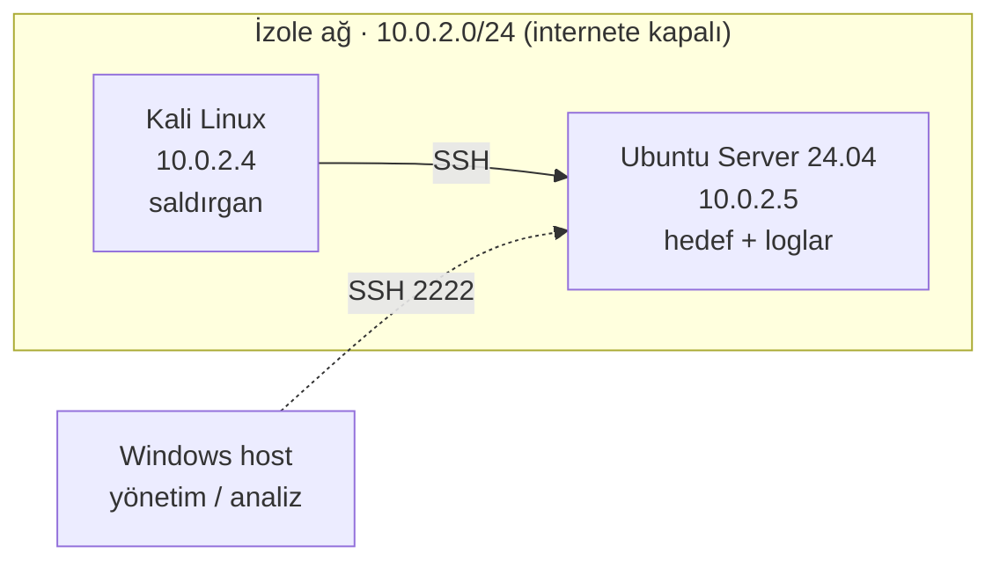

# home-lab

Saldırı tespiti (blue team) pratiği için kurduğum izole bir sanal lab ve içinde çalıştırdığım senaryoların dokümantasyonu.

Amaç: kontrollü bir ortamda saldırı izleri üretip bunların loglarda nasıl göründüğünü ve nasıl tespit edildiğini belgelemek. Her senaryo **saldırı → log → tespit** akışıyla yazılır.

> Tüm çalışmalar yalnızca bu lab'a ait, internete kapalı sanal makineler üzerinde yapılır.

## Lab mimarisi

| Makine | Rol | Not |
|---|---|---|
| Ubuntu Server 24.04 | Hedef | OpenSSH açık, `/var/log/auth.log` buradan toplanır |
| Kali Linux | Saldırgan | Senaryolar buradan çalıştırılır |
| Windows (host) | Yönetim | Logları analiz için buraya çeker |

- **Sanallaştırma:** VirtualBox 7.2
- **Ağ:** NAT Network (`10.0.2.0/24`). Makineler birbirini görür, ev ağındaki diğer cihazlar bunlara erişemez.
- **Snapshot:** Her makinenin temiz bir kurulum snapshot'ı var; senaryo sonrası bu ana dönülür.

## Senaryolar

| # | Senaryo | Teknik | Durum |
|---|---|---|---|
| 1 | [SSH brute force ve tespiti](senaryolar/01-ssh-brute-force.md) | T1110.001, T1078.003 | ✅ |
| 2 | [Başarısız yetki yükseltme denemesi](senaryolar/02-yetki-yukseltme-denemesi.md) | T1548.003 | ✅ |

## İlgili proje

Loglar [auth-log-analyzer](https://github.com/yusufiyilmaz/auth-log-analyzer) aracıyla analiz edilir. Bu lab, o aracı gerçek loglarla test etmek için de kullanıldı.

## Kurulum notları

Ayrıntılı kurulum adımları [docs/kurulum.md](docs/kurulum.md) dosyasındadır.
